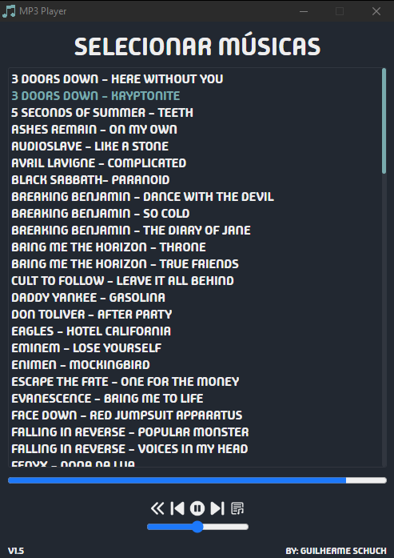

# EchoDeck

[]()


A simple local MP3 player with persistent playlists and Discord Rich Presence.


## Table of Contents

- [About](#about)

- [Demo](#demo)

- [Features](#features)

- [Shortcuts](#shortcuts)

- [Contact](#features)
  

## About

A software made with Electron which have one simple objective, play mp3 files ;)

## Demo



<hr>
  

## Features

- Play mp3 files.
- Create and persist multiple playlists.
- Restore missing songs with a file picker or remove them from a playlist.
- Adjust and persist per-song gain.
- Show the current song in Discord when Discord is running.

## Discord Rich Presence

Create an application named `EchoDeck` in the Discord Developer Portal and put its application ID in the root `.env` file:

```text
DISCORD_CLIENT_ID=your_discord_application_id
```

Discord’s desktop application must be running for the current song to appear in a profile. The ID is an application identifier, not a secret; the `.env` file is still ignored so local configuration is not committed.

EchoDeck publishes a **Playing** activity with its elapsed timestamp anchored to the audio player's current position. It refreshes the anchor on track changes, seeks, restarts, and resumes; timestamps are omitted while paused because Discord RPC has no pause control for its timer. The activity image must use the exact uploaded asset key. The current configured key is `logo_1_1_`, matching the asset in the EchoDeck Discord application under **Rich Presence → Art Assets**. If you replace or rename that asset, update `large_image` in `src/js/discord-presence.js` to match.

  
## Shortcuts

|SHORTCUT                        |ACTION                         
|--------------------------------|-------------------------------
|CommandOrControl+num9           |`Play next song`
|CommandOrControl+num8           |`Toggle pause/play`
|CommandOrControl+num7           |`Play previous song`
|CommandOrControl+num6           |`Forward 1 sec`
|CommandOrControl+num5           |`Restart song`
|CommandOrControl+num4           |`Go back 1 sec`
|CommandOrControl+num3           |`Volume up`
|CommandOrControl+num2           |`Toggle mute`
|CommandOrControl+num1           |`Volume down`
